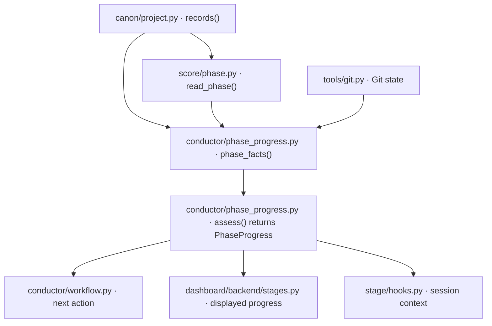

# Architecture

Agent skills carry out work and record what happened. Canon stores the plan and
evidence, Score and Tuner give those records meaning, and Conductor uses them with
Git state to decide what can happen next. The CLI, session handoff, and dashboard
use those decisions through their own interfaces. See [Design](DESIGN.md) for the
trade-offs and the [boundary tests](tests/test_boundaries.py) for allowed imports.

## Records, planning, and evidence

| Package | Modules to read |
|---|---|
| **Canon** | [`workspace.py`](orchestra/canon/workspace.py) resolves which store to open. [`project.py`](orchestra/canon/project.py) exposes `get()`, `records()`, and record mutations. [`schema.py`](orchestra/canon/schema.py) loads record definitions and [`validation.py`](orchestra/canon/validation.py) checks payloads, references, and transitions. [`backend.py`](orchestra/canon/backend.py) defines the storage contract and [`sqlite_backend.py`](orchestra/canon/sqlite_backend.py) implements it. [`derive.py`](orchestra/canon/derive.py) computes dependency readiness and waves. |
| **Score** | [`phase.py`](orchestra/score/phase.py), [`work_item.py`](orchestra/score/work_item.py), and [`acceptance.py`](orchestra/score/acceptance.py) read typed planning records. [`requirements.py`](orchestra/score/requirements.py) reads requirement definitions. [`workflow_reviews.py`](orchestra/score/workflow_reviews.py) checks whether approvals still apply, and [`analyze.py`](orchestra/score/analyze.py) checks plan consistency. |
| **Tuner** | [`records.py`](orchestra/tuner/records.py) defines `CheckRun`, `Finding`, and `EvidenceBinding`. [`manifest.py`](orchestra/tuner/manifest.py) loads claims at a Git revision. [`verdict.py`](orchestra/tuner/verdict.py) evaluates those claims and [`binding.py`](orchestra/tuner/binding.py) associates observations with them. [`technique.py`](orchestra/tuner/technique.py) defines the verification plugin interface. |
| **Composer** | [`records.py`](orchestra/composer/records.py) models ideas, areas, and placements. [`idea.py`](orchestra/composer/idea.py) captures ideas, and [`placement.py`](orchestra/composer/placement.py) assigns an effort to an area. |

The [schema registrations](pyproject.toml) point to each package's record types
and lifecycles. Canon validates writes against the store's schema snapshots.

## Conductor operations

| Question | Modules to read |
|---|---|
| **What step is open?** | [`phase_progress.py`](orchestra/conductor/phase_progress.py) gathers `PhaseFacts` and computes `PhaseProgress`. [`workflow.py`](orchestra/conductor/workflow.py) uses that result, run scope, and blockers to choose an action. [`briefs/render.py`](orchestra/conductor/briefs/render.py) assembles the agent instructions. |
| **Where is approval recorded?** | [`workflow_review.py`](orchestra/conductor/workflow_review.py) checks authority and records a step review. Score's [`workflow_reviews.py`](orchestra/score/workflow_reviews.py) evaluates that review when the plan is read. |
| **Why is this task ready or done?** | [`wave.py`](orchestra/conductor/wave.py) selects and starts ready work. [`task_landing.py`](orchestra/conductor/task_landing.py) coordinates task landing and closure. [`land_task.py`](orchestra/conductor/land_task.py) handles the task's code and evidence, and [`task_close.py`](orchestra/conductor/task_close.py) evaluates the conditions for transitioning it to `done`. |
| **Why does this check count?** | [`check.py`](orchestra/conductor/check.py) runs an acceptance command and records a `tuner:check-run`. [`head_evidence.py`](orchestra/conductor/head_evidence.py) selects eligible check-runs for an acceptance and revision. [`requirements.py`](orchestra/conductor/requirements.py) combines those results into requirement status. |
| **Where does phase-wide evidence come from?** | [`suite.py`](orchestra/conductor/suite.py) handles suite runs and policy. [`reviewer.py`](orchestra/conductor/reviewer.py) prepares review inputs and interprets reviewer output. |
| **Why can the phase land?** | [`gate.py`](orchestra/conductor/gate.py) evaluates landing conditions. [`landing.py`](orchestra/conductor/landing.py) reads the worktree location, proof packet, and landing record. [`land.py`](orchestra/conductor/land.py) checks the gate and invokes the adapter. [`github_pr.py`](orchestra/conductor/github_pr.py) handles the GitHub interaction, and [`close.py`](orchestra/conductor/close.py) handles closure after merge. |

## Interfaces and external commands

- **CLI and skills.** [`orchestra/cli.py`](orchestra/cli.py) composes the package commands. [`tools/command_kit.py`](orchestra/tools/command_kit.py) defines command registration, dispatch, and CLI errors. [`conductor/cli/workflow_commands.py`](orchestra/conductor/cli/workflow_commands.py) maps `workflow` commands to Conductor functions. Skills use the briefs those functions render.
- **Terminal and sessions.** [`views/render.py`](orchestra/views/render.py) formats record views. [`stage/hooks.py`](orchestra/stage/hooks.py) assembles session context with [`stage/handoff.py`](orchestra/stage/handoff.py).
- **Dashboard.** [`server/app.py`](dashboard/backend/server/app.py) defines the HTTP routes. [`server/service.py`](dashboard/backend/server/service.py) assembles responses and manages the cache. [`stages.py`](dashboard/backend/stages.py) reads shared phase progress, and [`phase.py`](dashboard/backend/phase.py) builds phase details for the UI.
- **External commands.** [`tools/cli_tool.py`](orchestra/tools/cli_tool.py) provides the process runner. [`tools/git.py`](orchestra/tools/git.py) wraps Git and exposes branch state used by progress and close.

## Follow a phase from records to screen

Arrows show how the phase assessment is built and used.

For example, a phase with approved spec and design can stay at `tasks` because its
plan lacks work-items. Start with `assess()` in [phase progress](orchestra/conductor/phase_progress.py)
to see how it picks the first open stage, then read [the test for this case](tests/test_phase_progress_model.py).
